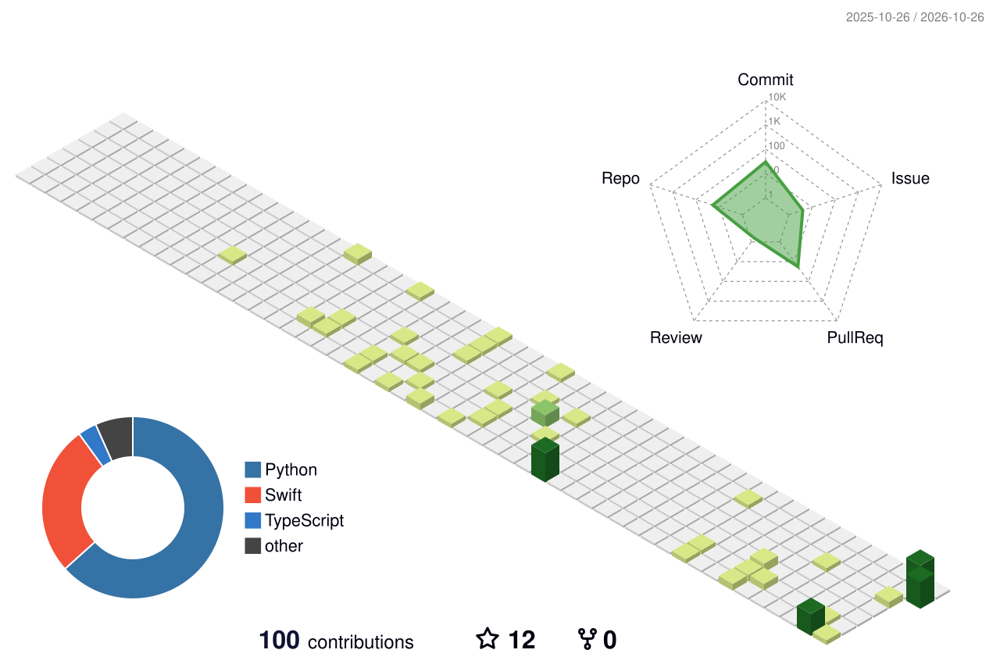

# Hi, I'm panda-z519 👋

**English** · [简体中文](./README.zh-CN.md)

---

### 🧑‍💻 About me

- I like building **small, sharp tools**: menu-bar apps, launchers, scripts — things you install once and stop noticing.
- Mostly working on **macOS desktop utilities** (Swift / SwiftUI) and **AI-agent workflows** (Claude Code, Codex).
- Everything I ship tries to be **local-first** and respectful of your privacy.
- A regular at the [**LINUX DO**](https://linux.do) community — I even wrote [a userscript](https://github.com/panda-z519/linuxdo-script) to save its threads into Obsidian.

### 🚀 Featured projects

| Project | What it does | Stack |
| :-- | :-- | :-- |
| [**MyFan**](https://github.com/panda-z519/MyFan) | Menu-bar fan control and system monitor for Apple Silicon Macs: presets, temperature curves, CPU / memory / network / battery |  |
| [**LockIME-Voice**](https://github.com/panda-z519/LockIME-Voice) | macOS menu-bar input-source locker with a configurable voice-input workflow |  |
| [**QuickTab**](https://github.com/panda-z519/QuickTab) | Spotlight-style launcher to search and switch browser tabs, bookmarks and history |  |
| [**NearLock**](https://github.com/panda-z519/NearLock) | Auto-locks your Mac when you walk away, using an Android phone as a BLE beacon |   |
| [**agent-session-titles**](https://github.com/panda-z519/agent-session-titles) | One command to give Claude Code & Codex sessions auto-updating, readable titles |  |
| [**imefuse**](https://github.com/panda-z519/imefuse) | Move personal word-frequency data between macOS Chinese IMEs (WeType / Sogou / Doubao). Merge, never overwrite — all three formats reversed byte by byte |  |
| [**linuxdo-script**](https://github.com/panda-z519/linuxdo-script) | Userscript that saves linux.do threads into Obsidian as Markdown notes |  |

### 🛠️ Tech stack

  

### 📈 Activity

<picture>
  <source media="(prefers-color-scheme: dark)" srcset="./profile-3d-contrib/profile-night-green.svg">
  <source media="(prefers-color-scheme: light)" srcset="./profile-3d-contrib/profile-green-animate.svg">
  
</picture>

---

💬 Ideas, bugs or just saying hi — feel free to open an issue in any of my repos.

